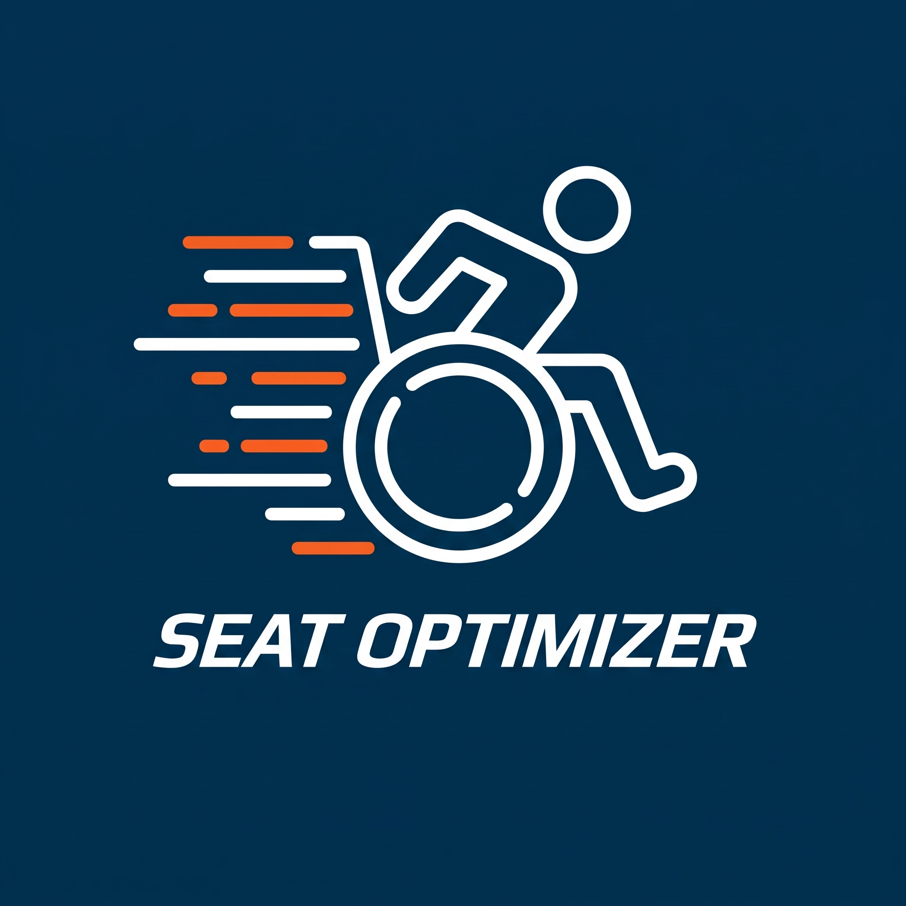

<p align="center">
  
</p>

<h1 align="center">SiadaICie</h1>

<p align="center">
  <em>Koniec z koczowaniem na korytarzu przy toalecie. Usiądź jak człowiek.</em>
</p>

<p align="center">
  <a href="https://github.com/Anonpaweu/SiadaICie/releases"></a>
  <a href="https://buycoffee.to/anonpaweu"></a>
</p>

<p align="center">
  <a href="https://www.python.org/downloads/"></a>
  <a href="https://fastapi.tiangolo.com"></a>
  <a href="https://playwright.dev/python/"></a>
  
  
</p>

---

## Jak znaleźć wolne miejsce siedzące w przepełnionym pociągu PKP Intercity?

**SiadaICie** to darmowa aplikacja (na Androida oraz PC Web), która znajduje wolne miejsca siedzące w przepełnionych pociągach PKP Intercity (IC, TLK, EIC, EIP), nawet gdy system e-IC pokazuje brak miejsc na całą trasę. Aplikacja sprawdza schematy wagonów odcinek po odcinku i układa przejazd z przesiadką między wolnymi fotelami w tym samym pociągu albo wskazuje niezarezerwowane miejsca w trakcie jazdy z biletem bez gwarancji.

---

## Pobierz na Androida i zobacz jak działa

Najprościej zainstalować gotową aplikację na telefonie (Android 10+ / API 29+):

1. Pobierz najnowszy plik `.apk` ze strony **[GitHub Releases](https://github.com/Anonpaweu/SiadaICie/releases)** bezpośrednio na telefon.
2. Otwórz pobrany plik i zezwól na instalację z nieznanych źródeł (jeśli Google Play Protect poprosi o potwierdzenie dla aplikacji spoza Sklepu Play, wybierz *„Zainstaluj mimo to”*).

### Demo działania (e-IC pokazuje brak miejsc -> SiadaICie znajduje fotele i siatkę miejsc)

https://github.com/user-attachments/assets/398321dd-2f49-4fc7-af03-6585f12016a5

---

## O co w tym chodzi? (prosty przykład z życia)

Znasz to uczucie? Jest niedzielne popołudnie, koniec długiego weekendu albo święta. Chcesz kupić bilet na pociąg przez pół Polski (np. z Warszawy do Wrocławia przez Koluszki, Piotrków, Częstochowę i Opole). Wchodzisz do e-IC, a tam komunikat: **„Brak wolnych miejsc do siedzenia”**.

**Kolej to nie samolot.** Pociąg zatrzymuje się po drodze na kilkunastu stacjach, więc ludzie nieustannie wsiadają i wysiadają:
- Ktoś wysiada w Koluszkach — jego fotel zwalnia się na resztę trasy.
- Ktoś inny wsiada dopiero w Opolu — do Opola to miejsce stoi puste.

System kolejowy przy próbie zakupu biletu na **całą relację** mówi „nie ma miejsc”, bo żaden pojedynczy fotel nie jest wolny od stacji początkowej do samego końca. Wystarczy kupić **dwa lub trzy bilety cząstkowe** na kolejne odcinki i w trakcie podróży przesiąść się na inny wolny fotel — i całą trasę pokonujesz wygodnie na siedząco.

**Jeszcze prostsza analogia:** chcesz jechać ze stacji **A** do **Z**. Akurat między przystankami **G** i **H** (jeden 20-minutowy odcinek w środku trasy) wsiada duża grupa i zajmuje wszystkie fotele w całym pociągu. System PKP IC powie Ci wtedy krótko: *„brak gwarancji miejsca siedzącego na całą trasę A–Z”* i w ogóle nie podpowie alternatywy — choć w praktyce od **A do G** możesz jechać na siedząco, na tym jednym odcinku **G–H** postać 20 minut, a od **H do Z** znów usiąść na gwarantowanym miejscu. SiadaICie wyłapuje dokładnie takie sytuacje.

### Jak znaleźć wolne miejsce w pociągu PKP Intercity z biletem bez gwarancji miejsca?

**Jadąc pociągiem PKP Intercity z biletem bez gwarancji miejsca, możesz w aplikacji SiadaICie sprawdzić aktualnie niezarezerwowane fotele na pozostałej części trasy.** Wystarczy rozwinąć przystanki swojego pociągu, wskazać najbliższą stację przed sobą i uruchomić skan. SiadaICie odczyta bieżący stan rezerwacji w systemie PKP IC i pokaże na siatce miejsc, w którym wagonie oraz na których numerach nikt nie ma wykupionej miejscówki (system widzi oczywiście brak rezerwacji, a nie to, czy fizycznie nie usiadł tam już ktoś inny bez miejscówki — ale i tak oszczędza sporo bezsensownego chodzenia po składzie).

---

## Jak korzystać z SiadaICie?

Wyszukanie wolnych miejsc siedzących w pociągu PKP Intercity z pomocą SiadaICie zajmuje cztery kroki:

1. **Wpisz stację odjazdu i docelową** — np. *Wrocław Główny* -> *Warszawa Centralna* (autouzupełnianie podpowie oficjalne nazwy stacji).
2. **Wybierz datę, opcjonalnie minimalną godzinę odjazdu, klasę (2 lub 1) oraz filtry miejsc** (domyślnie aktywne są zwykłe fotele, Strefa ciszy oraz miejsca z rowerem).
3. **Wyszukaj połączenia i kliknij „Skanuj”** — możesz zminimalizować aplikację na telefonie, skanowanie działa w tle i powiadomi Cię po zakończeniu.
4. **Wybierz najwygodniejszy wariant podróży** (np. *Zbalansowany* lub *Minimum przesiadek*), obejrzyj siatkę wolnych miejsc i kup wskazane bilety cząstkowe bezpośrednio przez linki do oficjalnego e-IC.

---

## Co potrafi SiadaICie?

- **Działa na Androidzie (w tle) oraz na komputerze (PC Web):** na telefonie ma wbudowaną bazę stacji offline, historię **3 ostatnich analiz (wygasających po 1 godzinie)**, jasny/ciemny motyw i powiadomienia po zakończeniu skanu.
- **Skanuje sprytnie i szybko:** najpierw sprawdza całą trasę w trybie **Fast-Path** (jeśli jest choć jedno wolne miejsce na 100% drogi, wynik wraca od razu — z opcją ręcznego wymuszenia pełnego skanowania wszystkich odcinków), a przy pełnym skanie pobiera schematy bezpośrednio przez API GRM.
- **Ogarnia pociągi bez schematu wagonów (np. IC Orzeszkowa):** automatycznie rozpoznaje składy bez graficznej mapki miejsc i bez blokowania biletów wyznacza najdłuższe odcinki z gwarantowanym miejscem siedzącym.
- **Uczciwie rozróżnia statusy e-IC i filtry miejsc:** pokazuje zwykłe fotele i Strefę ciszy w pierwszej kolejności, podpowiada gdy włączenie filtra *Rower* ratuje przed staniem, wypisuje dokładne typy dostępnych miejsc specjalnych w nawiasie (np. *Senior*, *Kobieta w ciąży*), informuje gdy bilety zostały tylko w 1. klasie i przekreśla odjechane już dziś przystanki.
- **Interaktywna siatka wolnych miejsc i plan zakupu:** przejrzysta oś czasu z linkami do e-IC oraz siatka wszystkich wagonów i miejsc na każdym odcinku (z pomarańczowym oznaczeniem miejsc specjalnych).
- **Radar nocnej przerwy serwisowej:** ostrzega o codziennym oknie konserwacyjnym systemów kolejowych (**23:45 – 00:30**, a na przełomie miesięcy do **01:00**).

---

## Najczęstsze pytania (FAQ)

### Dlaczego PKP Intercity pokazuje brak miejsc siedzących, skoro po drodze są wolne fotele?

System rezerwacyjny PKP Intercity (e-IC) przy zakupie jednego biletu na całą relację szuka pojedynczego fotela wolnego bez przerwy od stacji początkowej do końcowej. Gdy każdy fotel w pociągu jest zajęty choćby na jednym krótkim odcinku w środku trasy, e-IC oferuje wyłącznie bilet bez gwarancji miejsca — nawet jeśli po podzieleniu podróży na dwa bilety cząstkowe można przejechać całą trasę na siedząco z jedną przesiadką wewnątrz pociągu.

### Czy SiadaICie działa dla pociągów bez graficznego schematu wagonów (np. IC Orzeszkowa)?

Tak — SiadaICie obsługuje również pociągi PKP Intercity bez graficznej mapki miejsc w e-IC, takie jak popularny IC Orzeszkowa. Aplikacja automatycznie przełącza się w tryb odcinkowy, sprawdza dostępność bez blokowania biletów i wyznacza najdłuższe fragmenty trasy z gwarantowanym miejscem siedzącym przydzielanym automatycznie przez e-IC.

### Czy SiadaICie jest darmowe i czy samo rezerwuje lub blokuje bilety?

SiadaICie jest w pełni darmowym projektem open-source (licencja MIT) dostępnym na Androida (APK z GitHub Releases) oraz na PC Web. Aplikacja działa wyłącznie w trybie odczytu (read-only) — nie kupuje biletów, nie blokuje miejsc w systemie przewoźnika i po zakończeniu analizy odsyła bezpośrednio do oficjalnego serwisu e-IC.

### Dlaczego nie da się przeskanować samego odcinka Warszawa Zachodnia – Warszawa Centralna?

PKP Intercity w systemie e-IC nie prowadzi sprzedaży biletów na krótkie przejazdy wewnątrz tej samej aglomeracji (np. Warszawa Zachodnia – Warszawa Centralna lub Gdańsk Wrzeszcz – Gdańsk Główny). Na dłuższych trasach SiadaICie automatycznie łączy taki graniczny odcinek z sąsiednią stacją, a przy pojedynczym skanie wewnątrz aglomeracji informuje o ograniczeniu sprzedaży.

---

## Dla programistów (PC Web, architektura, budowanie APK i testy)

<details>
<summary><strong>Uruchomienie wersji PC Web (FastAPI + Playwright)</strong></summary>

### Wymagania
- **Python 3.10+** (zalecany Python 3.12)
- Przeglądarka Chromium dla Playwrighta

### Instalacja i start
```bash
git clone https://github.com/Anonpaweu/SiadaICie.git
cd SiadaICie

python -m venv venv
# Windows (PowerShell): .\venv\Scripts\Activate.ps1
# Windows (CMD):        .\venv\Scripts\activate.bat
# Linux / macOS:        source venv/bin/activate

pip install -r backend/requirements.txt
playwright install chromium
```

Uruchomienie:
- **Windows:** kliknij dwukrotnie `start_server.bat`.
- **Z konsoli:** `python -m uvicorn backend.app.main:app --host 127.0.0.1 --port 8000`

Przy pierwszym uruchomieniu serwer automatycznie utworzy bazę SQLite i przygotuje słownik oficjalnych stacji. Interfejs otwiera się pod adresem **[http://localhost:8000](http://localhost:8000)**.

</details>

<details>
<summary><strong>Budowanie aplikacji Android z kodu (gałąź android-dev)</strong></summary>

```bash
git checkout android-dev
cd android
./gradlew testDebugUnitTest assembleRelease
```

Wymagany JDK 17 oraz Android SDK. Na Windowsie do szybkiego wgrania zbudowanej aktualizacji na telefon przez ADB służy skrypt `android/install_on_android.bat` (zachowuje historię i ustawienia bez odinstalowywania poprzedniej wersji).

</details>

<details>
<summary><strong>Architektura projektu i uruchamianie testów</strong></summary>

```text
SiadaICie/
├── backend/                     # Aplikacja PC Web (FastAPI + Playwright)
│   ├── app/
│   │   ├── engine/              # Parsowanie dostępności, profile wag i topologia pociągu
│   │   ├── optimizer/           # Solwer grafowy DAG + Programowanie Dynamiczne
│   │   ├── scraper/             # Playwright scraper + parser SVG GRM + radar błędów
│   │   ├── db/                  # Baza SQLite (auto-inicjalizacja i seed stacji przy starcie)
│   │   ├── models/              # Schematy Pydantic i modele domenowe
│   │   └── main.py              # Aplikacja FastAPI (REST API + /api/v1/recompute)
│   ├── static/
│   │   └── index.html           # Interfejs Web (Tailwind CSS, Vanilla JS)
│   ├── tests/                   # Zestaw testów jednostkowych i integracyjnych (pytest)
│   └── requirements.txt         # Zależności Pythona
├── android/                     # Natywna aplikacja Android (Kotlin + Jetpack Compose, gałąź android-dev)
│   ├── app/src/main/java/pl/siadaicie/app/
│   │   ├── data/                # Baza stacji offline (stations.db) + historia 3 skanów (1h TTL)
│   │   ├── optimizer/           # Solwer DAG w Kotlinie z hierarchią priorytetów miejsc
│   │   ├── scraper/             # Skaner WebView + bezpośrednie zapytania GRM API
│   │   ├── service/             # ScanForegroundService (skanowanie w tle)
│   │   └── ui/                  # Ekrany Compose (Wyszukiwanie, Filtry, Wyniki, Ustawienia)
│   └── install_on_android.bat   # Skrypt aktualizacji APK przez ADB
├── docs/
│   └── logo.jpg                 # Logo projektu
├── start_server.bat             # Launcher serwera PC Web dla systemu Windows
└── README.md
```

Testy:
- **PC Web / Backend:** `pytest backend/tests/ -v`
- **Android (JUnit):** `cd android && .\gradlew.bat testDebugUnitTest`

</details>

---

## Wsparcie projektu

Jeśli aplikacja pomogła Ci uniknąć stania na korytarzu — **Pomogłem? [Buy me a coffee (BLIK / karta)](https://buycoffee.to/anonpaweu)**.

---

## Zastrzeżenie prawne (Disclaimer)

Projekt ma charakter wyłącznie edukacyjny, badawczy i hobbystyczny. Program służy do wspomagania planowania podróży i **nie dokonuje zakupu biletów ani nie rezerwuje miejsc na stałe** (działa w trybie odczytu / read-only). Projekt nie jest w żaden sposób powiązany z żadnym przewoźnikiem kolejowym.
